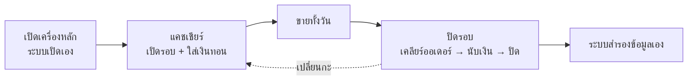
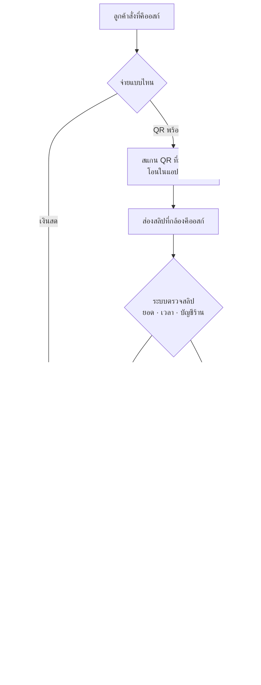

# 3. ลำดับการทำงาน

## หนึ่งวันของร้าน

1. **เช้า:** เปิดเครื่องหลัก (ระบบเปิดเองใน 3 นาที) → เปิดจอต่าง ๆ → แคชเชียร์ **เปิดรอบ** — ไม่เปิดรอบ คีออสก์รับออเดอร์ไม่ได้
2. **ระหว่างวัน:** ลูกค้าสั่งที่คีออสก์ → ครัวทำ → เรียกคิว → ส่งมอบ (ดูด้านล่าง)
3. **เปลี่ยนกะ:** ปิดรอบโดยเปิด "เปิดรอบใหม่ต่อทันที"
4. **ปิดร้าน:** ปิดรอบ → ระบบสำรองข้อมูลให้ · คืนนี้ 23:30 สำรองอีกรอบ

## ออเดอร์หนึ่งใบ — ตั้งแต่สั่งจนรับของ

**แบบข้อความ:**

- **เงินสด:** สั่ง → ได้เลขคิว → จ่ายที่เคาน์เตอร์ → ครัวทำ → จอเรียก → รับของ
- **QR:** สั่ง → สแกน QR โอน → ส่องสลิป → ระบบตรวจผ่าน → ครัวทำ → จอเรียก → รับของ
- **สลิปไม่ชัด:** ... → ระบบไม่แน่ใจ → แคชเชียร์ดูแอปธนาคารร้าน → ยืนยัน → ครัวทำ → ...

ระบบตรวจสลิป 3 อย่าง: **ยอดตรงบิล** · **เวลาโอนอยู่ในช่วงที่สั่ง** · **ผู้รับคือบัญชีร้าน** — ผ่านครบเข้าครัวเองไม่ต้องมีคนกด · สลิปเดียวใช้ซ้ำกับออเดอร์อื่นไม่ได้

## สถานะของออเดอร์ (ที่เห็นบนจอ)

| สถานะ | แปลว่า | ใครทำต่อ |
|---|---|---|
| **รอจ่าย** | สั่งแล้ว ยังไม่ได้เงิน | ลูกค้าโอน / แคชเชียร์รับเงินสด |
| **เช็กสลิป** | สลิปรอตรวจ · QR หมดเวลา · ตรวจไม่ผ่าน | แคชเชียร์ |
| **กำลังทำ** | ได้เงินแล้ว อยู่ที่ครัว | ครัว/บาร์ |
| **พร้อมรับ** | ทำเสร็จ จอเรียกคิวแล้ว | แคชเชียร์ส่งมอบ |
| **เสร็จ** | ลูกค้ารับของแล้ว | — |
| **ยกเลิก** | ยกเลิก · บิลผิด/ซ้ำ · คืนเงิน | — |

## กรณีพิเศษ

| เกิดอะไร | ทางไป |
|---|---|
| QR หมดเวลา (ตั้งต้น 150 วินาที) | คีออสก์ถาม "โอนแล้วหรือยัง?" → สแกนสลิป / ขอ QR ใหม่ / จ่ายเงินสดแทน · ไม่ตอบ 30 วินาที → ไปรอที่แท็บเช็กสลิป |
| ลูกค้าเปลี่ยนใจจ่ายเงินสด | กด **จ่ายเงินสดแทน** ที่คีออสก์ → ไปจ่ายที่เคาน์เตอร์ |
| ลูกค้ามีปัญหา | กด **แจ้งพนักงาน** → ขึ้นที่แท็บเช็กสลิป |
| ยกเลิกก่อนจ่าย | แคชเชียร์/ผู้จัดการ **ยกเลิก (ยังไม่ได้รับเงิน)** |
| จ่ายแล้วแต่บิลผิด/ซ้ำ | ผู้จัดการ **ยกเลิกบิลผิด/ซ้ำ** |
| ลูกค้าขอคืนเงิน | ผู้จัดการ **ยกเลิก + คืนเงินลูกค้า** แล้วคืนเงินเอง |
| พิมพ์ไม่ออก | ระบบลองซ้ำ 3 ครั้ง → ลองเครื่องสำรอง → แคชเชียร์เห็นแถบแดง กด **ดูและพิมพ์ซ้ำ** |
| ลูกค้าไม่มารับ | แคชเชียร์กด **เรียกซ้ำ** จอคิวเรียกอีกครั้ง |

## ใบที่พิมพ์ออก

| ใบ | ออกที่ไหน | เมื่อไหร่ |
|---|---|---|
| บัตรคิว | เครื่องพิมพ์ของคีออสก์ | สั่งเสร็จ |
| ใบเสร็จ | เคาน์เตอร์ | จ่ายแล้ว (ถ้าเปิดพิมพ์อัตโนมัติ) / กดพิมพ์เอง |
| สลิปครัว | เครื่องพิมพ์ของแต่ละสถานี (ไม่มีก็ออกที่เคาน์เตอร์) | จ่ายแล้ว |
| ใบปิดรอบ | — | กดดูที่หน้าปิดรอบ |
